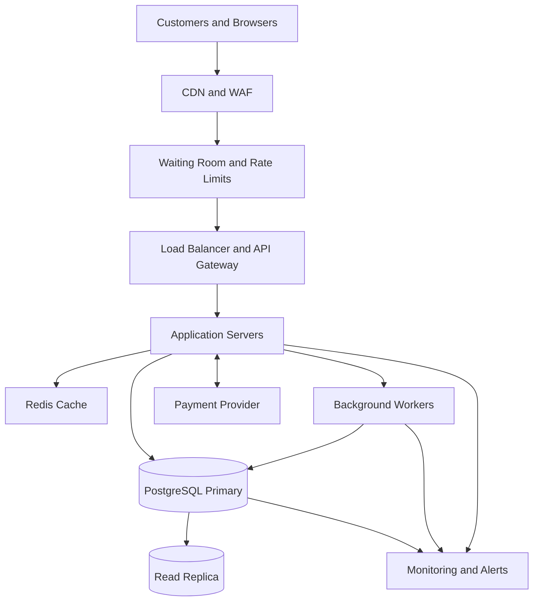

# TicketHub: Event Ticketing System Design

## 1. Context and Requirements

### 1.1 Context

TicketHub is an online ticketing platform that allows customers to browse events, view seat availability, reserve seats temporarily, purchase tickets, and access their confirmed tickets after payment.

The platform has approximately 2 million registered users and receives around 50,000 visitors per day. During a popular concert release, as many as 200,000 fans may attempt to purchase only 20,000 available seats within the first 10 minutes.

The main engineering challenge is handling sudden traffic spikes while ensuring that each seat is allocated to no more than one successful purchase.

The design therefore prioritizes correct seat allocation, reliable payment processing, fair access, security, and scalability.

### 1.2 Project Goals

The main goals of TicketHub are to:

- Allow customers to browse events and view event details.
- Display seat availability and ticket prices.
- Allow customers to hold available seats temporarily.
- Process purchases without double-booking seats.
- Allow customers to view their confirmed tickets and order history.
- Handle sudden traffic spikes during popular ticket releases.
- Provide clear feedback when seats become unavailable or payments fail.

### 1.3 Functional Requirements

The system must support the following functions:

1. Customers can register, log in, and manage their accounts.
2. Customers can browse events and view their dates, venues, and prices.
3. Customers can view the seats available for a particular event.
4. Customers can reserve one or more available seats temporarily.
5. The system automatically expires abandoned holds.
6. Customers can create orders and pay through an external payment provider.
7. Customers receive ticket confirmation after successful payment.
8. Customers can view their purchased tickets and order history.
9. The system prevents duplicate orders, duplicate payment processing, and double-booking.
10. The system provides clear error messages when a seat is unavailable, a hold expires, or a payment fails.

### 1.4 Non-Functional Requirements

**Performance**

Ordinary event browsing should target a response time below 200 milliseconds at the 95th percentile under normal load. Seat-hold requests should target a response time below 500 milliseconds at the 95th percentile under the planned peak load, excluding external payment-provider processing.

These targets must be verified through load testing.

**Consistency and correctness**

A seat must never be sold to more than one customer for the same event. Seat reservations and purchases must use database transactions and appropriate constraints. Retried requests and repeated payment callbacks must not create duplicate purchases or charges.

**Availability and reliability**

The initial service objective is 99.9% monthly availability. Multiple application instances, database backups, monitoring, and recovery procedures will help maintain service reliability.

**Fairness**

A virtual waiting room will control access during major ticket releases. Rate limits will reduce excessive requests, and customers will receive clear information about their queue position and reservation deadlines where supported.

**Security**

Customers must authenticate before placing holds, purchasing tickets, or accessing personal orders. Authorization checks must prevent users from viewing other customers' private information. TicketHub will use an external payment provider and will not store raw payment-card details.

**Scalability**

Application servers should scale horizontally. Event browsing should be separated from transactional seat allocation, and caching, queueing, and rate limiting should protect the database from sudden demand.

### 1.5 Non-Goals

The first version of TicketHub will not build its own payment-processing network, implement complex dynamic ticket pricing, or guarantee the elimination of all automated bots. It will focus on assigned seating, reliable purchases, and basic abuse prevention.

## 2. Traffic Estimates

### 2.1 Normal Traffic

TicketHub receives approximately 50,000 visitors per day. Assuming each visitor views 10 pages, the platform handles:

- Daily page views: 50,000 × 10 = 500,000.
- Average page requests per second: 500,000 ÷ 86,400 ≈ 5.8 requests per second.
- Estimated normal peak: 5 × 5.8 ≈ 29 page requests per second.
- Daily ticket sales: approximately 5,000.
- Average ticket sales rate: 5,000 ÷ 86,400 ≈ 0.058 sales per second.

These figures are estimates. Actual traffic depends on browsing patterns, cached requests, and the distribution of visitors throughout the day.

Under normal conditions, event browsing generates substantially more requests than successful purchases. Caching public event information can reduce unnecessary database queries.

### 2.2 Popular Concert Sale

During a major concert release, 200,000 people may attempt to buy 20,000 seats within 10 minutes.

Ten minutes equals 600 seconds.

The estimated purchase-attempt rate is:

200,000 ÷ 600 ≈ 333 purchase attempts per second.

Assuming each buyer makes four API requests during the process, including browsing seats, requesting a hold, creating an order, and checking payment status:

200,000 × 4 = 800,000 API requests.

The average API request rate during the sale is:

800,000 ÷ 600 ≈ 1,333 requests per second.

If traffic temporarily reaches three times this average, the system could experience approximately 4,000 requests per second.

The seat supply also limits successful purchases. With 20,000 available seats and 200,000 interested buyers, there are approximately 10 potential buyers per seat. No more than 20,000 successful seat purchases can be completed for this sale.

### 2.3 Traffic Implications for Architecture

The traffic estimates show that TicketHub must handle a significant difference between normal browsing activity and peak demand during a popular ticket sale. Normal traffic averages approximately 5.8 requests per second, while a major sale could generate bursts of approximately 4,000 requests per second.

These estimates influence several architectural decisions.

**Caching for Read-Heavy Traffic**

Browsing requests, such as retrieving event names, venue details, dates, and descriptions, often request the same information repeatedly. TicketHub can cache this public information using Redis and a content delivery network (CDN). This reduces repeated database queries and helps the application respond quickly during traffic spikes.

Seat availability can also be cached briefly for display purposes. However, cached information may become outdated when another customer reserves a seat. Therefore, the cache must never be the final authority for a reservation or purchase.

**Database Transactions for Seat Reservations**

Seat holds and purchases require stronger consistency than ordinary browsing. Every reservation must be validated against the authoritative PostgreSQL database. Database transactions, row-level locks, and appropriate uniqueness constraints prevent two customers from successfully purchasing the same seat.

Even if thousands of customers request the same seat simultaneously, the database must ensure that only one valid reservation can succeed.

**Waiting Room and Rate Limiting**

A virtual waiting room can control how quickly customers enter the application during a major sale. Rate limiting helps reduce excessive requests and repeated retries. Together, these measures protect the application servers and database from sudden traffic surges.

The admission rate should be adjusted according to measured system capacity rather than assuming that the database can handle every incoming request.

**Separating Browsing from Purchasing**

Event browsing generates many read requests, while seat holds and purchases require transactional writes. Separating these workloads allows TicketHub to cache public information and use read replicas for suitable queries while directing reservation and purchase operations to the primary database.

**Conclusion**

The key architectural decision is to optimize browsing for speed while prioritizing correctness for seat reservations and purchases. Caching, controlled admission, horizontal application scaling, and database transactions work together to handle peak demand without compromising seat allocation.


## 3. API Design

The API uses JSON for request and response bodies. Customers must authenticate before creating holds, purchasing tickets, cancelling their holds, or viewing personal tickets.

Requests that create holds, orders, or payments use idempotency keys. An idempotency key allows the system to recognize a repeated request and return the existing result rather than creating a duplicate operation.

### 3.1 Browse Events

**Endpoint:** `GET /api/events?page=1&limit=20`

This endpoint returns a paginated list of published events.

A successful request returns `200 OK`.

Example response:

```json
{
  "events": [
    {
      "id": "evt_101",
      "name": "Summer Music Festival",
      "venue": "Central Arena",
      "startsAt": "2027-06-15T18:00:00Z"
    }
  ],
  "page": 1,
  "limit": 20
}
```

Public event information can be cached to reduce database load.

### 3.2 View Event Details and Seat Availability

**Endpoint:** `GET /api/events/{eventId}`

This endpoint returns event details, including the name, venue, date, ticket prices, and sale status.

**Endpoint:** `GET /api/events/{eventId}/seats`

This endpoint returns the seats associated with the event and their displayed availability.

Example response:

```json
{
  "eventId": "evt_101",
  "seats": [
    {
      "seatId": "seat_A12",
      "label": "A12",
      "status": "available",
      "price": 75.00,
      "currency": "USD"
    },
    {
      "seatId": "seat_A13",
      "label": "A13",
      "status": "held",
      "price": 75.00,
      "currency": "USD"
    }
  ]
}
```

A successful request returns `200 OK`.

Displayed availability can become outdated immediately after a response. The backend must check the authoritative database again when a customer requests a hold.

### 3.3 Hold Seats

**Endpoint:** `POST /api/events/{eventId}/holds`

This authenticated endpoint temporarily reserves one or more available seats.

Example request:

```json
{
  "seatIds": ["seat_A12", "seat_A13"],
  "idempotencyKey": "hold-request-123"
}
```

A successful request returns `201 Created`.

Example response:

```json
{
  "holdId": "hold_501",
  "seatIds": ["seat_A12", "seat_A13"],
  "status": "active",
  "expiresAt": "2027-06-15T17:05:00Z"
}
```

A hold lasts five minutes from creation unless the system explicitly applies a different policy.

The backend must reserve all requested seats in one database transaction. If any requested seat is unavailable, the transaction must fail without leaving a partial reservation.

Possible responses include:

- `201 Created`: The hold was created successfully.
- `401 Unauthorized`: The customer is not authenticated.
- `409 Conflict`: One or more requested seats are already held or sold.
- `429 Too Many Requests`: The customer has exceeded a rate limit.

Repeated requests with the same idempotency key must not create duplicate holds.

### 3.4 Cancel a Hold

**Endpoint:** `DELETE /api/holds/{holdId}`

This authenticated endpoint releases an active hold owned by the customer.

A successful request returns `204 No Content`.

The backend checks ownership and the current state of the hold before releasing any seats. A cancellation request must not release seats that have already been sold or finalized.

### 3.5 Create an Order

**Endpoint:** `POST /api/orders`

This endpoint creates an order using a valid hold.

Example request:

```json
{
  "holdId": "hold_501",
  "idempotencyKey": "order-request-789"
}
```

The backend verifies that the hold belongs to the customer, remains valid, and contains the requested seats. It then creates an order in the `pending_payment` state.

A successful request returns `201 Created`.

Example response:

```json
{
  "orderId": "ord_901",
  "status": "pending_payment",
  "amount": 150.00,
  "currency": "USD"
}
```

If the hold has expired or is no longer valid, the backend returns `409 Conflict`.

The order creation request must be idempotent so that a network retry does not create another order for the same operation.

### 3.6 Process Payment

**Endpoint:** `POST /api/orders/{orderId}/payment`

This endpoint starts or checks payment processing through an external payment provider.

Example request:

```json
{
  "paymentMethodToken": "provider-token-123",
  "idempotencyKey": "payment-request-456"
}
```

The payment token is supplied by the payment provider. TicketHub does not store raw card details.

Possible responses include:

- `200 OK`: Payment has been confirmed.
- `202 Accepted`: Payment is still processing.
- `402 Payment Required`: Payment was declined.
- `409 Conflict`: The order is no longer eligible for payment.

The backend must verify payment-provider notifications before marking an order as paid. Duplicate callbacks must not create duplicate tickets.

### 3.7 View My Tickets

**Endpoint:** `GET /api/me/tickets`

This authenticated endpoint returns tickets belonging to the current customer.

Example response:

```json
{
  "tickets": [
    {
      "ticketId": "tkt_301",
      "eventId": "evt_101",
      "eventName": "Summer Music Festival",
      "seatLabel": "A12",
      "status": "valid"
    }
  ]
}
```

A successful request returns `200 OK`.

The backend must verify ownership and return only tickets the authenticated customer is authorized to access.

### 3.8 API Error Handling

The API uses consistent error responses.

Example:

```json
{
  "error": {
    "code": "SEAT_UNAVAILABLE",
    "message": "One or more selected seats are no longer available."
  }
}
```

Common HTTP status codes include:

- `200 OK`: A request succeeded.
- `201 Created`: A new resource was created.
- `202 Accepted`: An operation is still processing.
- `204 No Content`: An operation succeeded without a response body.
- `401 Unauthorized`: Authentication is missing or invalid.
- `403 Forbidden`: The customer lacks permission.
- `404 Not Found`: The requested resource does not exist.
- `409 Conflict`: A seat, hold, or order conflicts with its current state.
- `429 Too Many Requests`: A rate limit was exceeded.
- `500 Internal Server Error`: An unexpected server error occurred.

## 4. Data Model and Database Schema

TicketHub uses PostgreSQL as its authoritative relational database. The database separates customer information, event information, physical seats, event-specific seat inventory, temporary holds, orders, and purchased order items.

The design uses seven tables: `users`, `events`, `seats`, `event_seats`, `holds`, `orders`, and `order_items`. Each table has a specific responsibility, and foreign keys maintain the relationships between records.

### 4.1 Users Table

The `users` table stores information about registered customers.

It contains the following fields:

- `user_id`: UUID primary key that uniquely identifies each customer.
- `name`: The customer's display name.
- `email`: The customer's email address, which must be unique.
- `password_hash`: A securely generated password hash rather than a plain-text password.
- `created_at`: The date and time the account was created.

One user can create multiple holds and orders. The `user_id` field is referenced by the `holds` and `orders` tables.

### 4.2 Events Table

The `events` table stores information about events available on TicketHub.

It contains:

- `event_id`: UUID primary key identifying the event.
- `name`: The event name.
- `venue`: The venue where the event takes place.
- `starts_at`: The scheduled event date and time.
- `status`: The event's publication or sale status, such as draft, published, or cancelled.

One event can have many event-seat inventory records. The `event_id` field is referenced by the `event_seats`, `holds`, and `orders` tables.

### 4.3 Seats Table

The `seats` table describes the physical seats available at a venue.

It contains:

- `seat_id`: UUID primary key identifying the physical seat.
- `venue`: The venue identifier or venue name.
- `seat_label`: A label such as A12 or B07.
- `section`: The seating section.

A unique constraint on `(venue, seat_label)` prevents duplicate seat labels within the same venue.

This table describes the physical seating arrangement. It does not determine whether a seat is available for purchase at a particular event. That information belongs in the `event_seats` table.

### 4.4 Event Seats Table

The `event_seats` table stores the inventory state of each physical seat for a particular event. It is the authoritative source for deciding whether a seat is available, held, or sold.

It contains:

- `event_id`: Foreign key referencing the `events` table.
- `seat_id`: Foreign key referencing the `seats` table.
- `price`: The ticket price for that seat at that event.
- `status`: The current inventory state, such as available, held, or sold.
- `hold_id`: The identifier of the active hold, when applicable.
- `hold_expires_at`: The expiration time of the active hold, when applicable.

The combination of `event_id` and `seat_id` forms the composite primary key. This ensures that only one inventory record exists for a particular seat at a particular event.

The `status` field determines whether the seat can be held or sold. All changes to this field must be performed through database transactions.

When a hold expires, the seat can return to the available state only if it is still associated with that expired hold and has not been sold or reassigned.

### 4.5 Holds Table

The `holds` table records temporary seat reservations created by customers.

It contains:

- `hold_id`: UUID primary key identifying the hold.
- `user_id`: Foreign key referencing the customer who created it.
- `event_id`: Foreign key referencing the event.
- `status`: The hold state, such as active, expired, cancelled, or converted.
- `expires_at`: The time when the hold expires.
- `idempotency_key`: A key used to recognize repeated hold-creation requests.
- `created_at`: The date and time the hold was created.

A hold can cover multiple seats. The corresponding `event_seats` records store the same `hold_id` for the seats reserved by that hold.

The application creates the hold record and updates the associated inventory records within the same database transaction. If any requested seat is unavailable, the transaction rolls back.

The system must validate that the hold belongs to the authenticated customer before allowing it to be cancelled or used to create an order.

### 4.6 Orders Table

The `orders` table records customers' purchase attempts.

It contains:

- `order_id`: UUID primary key identifying the order.
- `user_id`: Foreign key referencing the customer.
- `hold_id`: Foreign key referencing the hold used for the purchase.
- `total`: The total amount payable.
- `status`: The order state, such as pending payment, paid, failed, or cancelled.
- `idempotency_key`: A key that prevents repeated requests from creating duplicate orders.
- `created_at`: The date and time the order was created.

An order initially has the status `pending_payment`. It becomes `paid` only after TicketHub verifies successful payment with the payment provider.

The application must not issue tickets simply because an order has been created. Order creation, payment confirmation, and final seat allocation must follow a controlled process.

### 4.7 Order Items Table

The `order_items` table connects an order to the individual seats included in a purchase.

It contains:

- `order_item_id`: UUID primary key identifying the order item.
- `order_id`: Foreign key referencing the `orders` table.
- `event_id`: Identifies the event associated with the purchased seat.
- `seat_id`: Identifies the physical seat being purchased.
- `price`: The price recorded for the seat at the time of the order.

The combination of `event_id` and `seat_id` identifies the corresponding inventory record in `event_seats`.

A foreign key on `(event_id, seat_id)` references the composite primary key of `event_seats`. This prevents an order item from referring to an inventory record that does not exist.

The application must ensure that a seat is allocated to no more than one successful purchase. The authoritative `event_seats` record is locked and changed to `sold` inside a transaction when the purchase is finalized.

The system should also enforce uniqueness for finalized seat allocations. If `order_items` contains only confirmed purchases, a unique constraint on `(event_id, seat_id)` can prevent duplicate allocations. If it also stores pending or failed attempts, the implementation must enforce uniqueness specifically for successful allocations rather than incorrectly preventing legitimate retries.

### 4.8 Relationships Between Tables

The tables are connected through primary keys and foreign keys.

One user can create multiple holds and orders. One event can have many event-seat inventory records. One physical seat can be associated with different events, while each event-seat combination has only one inventory record.

One hold can temporarily reserve several event seats. One order can contain multiple order items, and each order item identifies a seat associated with a specific event.

These relationships allow TicketHub to track customers, reservations, and purchases without mixing physical seat information with event-specific availability.

### 4.9 Indexes and Constraints

The database uses primary keys, foreign keys, unique constraints, and indexes to preserve data integrity and support efficient queries.

Important constraints and indexes include:

- A unique constraint on the customer email address.
- A unique constraint on `(venue, seat_label)` in the `seats` table.
- A composite primary key on `(event_id, seat_id)` in `event_seats`.
- An index on `event_seats(event_id, status)` to support seat-availability queries.
- An index on `event_seats(hold_expires_at)` to help locate expired holds.
- An index on `orders(user_id, created_at)` to support customer order history.
- Unique idempotency keys within the appropriate customer or request scope.
- A database-enforced rule preventing the same event-seat combination from being allocated to multiple successful purchases.

Database constraints are essential safeguards, but they do not replace transactions. The application must use transactions and row-level locking when reserving seats and finalizing purchases.

PostgreSQL is the final authority for seat allocation. Application-level checks and cached availability data alone are not sufficient to prevent double-booking.

## 5. Preventing Double-Booking

### 5.1 The Concurrency Problem

Double-booking occurs when two customers attempt to reserve or purchase the same seat at almost the same time.

For example, Alice and Brian may both see seat A12 displayed as available. If the application checks availability before updating the database, both requests might pass the check before either one changes the seat's status.

TicketHub prevents this race condition by combining PostgreSQL transactions, row-level locking, conditional state changes, and database constraints.

The `event_seats` table is the authoritative source of seat availability. The `seats` table describes physical seats, while `event_seats` records whether a particular seat is available, held, or sold for a specific event.

### 5.2 Seat-Hold Strategy

When a customer requests one or more seats, the application begins a database transaction.

It locks the relevant `event_seats` records using `SELECT ... FOR UPDATE`. This prevents competing transactions from simultaneously modifying the same inventory records without waiting.

The application then checks the status and hold expiration time of each requested seat using the database's current time.

If every requested seat is available, or has an expired hold that can safely be replaced, the application changes the seats to `held`, associates them with the new `hold_id`, and sets the hold expiration time.

The application creates the corresponding record in the `holds` table and updates all requested inventory records within the same transaction.

If any requested seat is unavailable, the application rolls back the entire transaction and returns `409 Conflict`. This prevents a customer from receiving only part of a multi-seat reservation.

When locking multiple seats, the application should lock them in a consistent order to reduce the risk of deadlocks.

The identifiers below are illustrative placeholders; production requests must use valid IDs matching the database column types.


### 5.3 Example SQL Transaction

The following SQL illustrates how TicketHub can lock and reserve two seats for one event.

```sql
BEGIN;

SELECT event_id, seat_id, status, hold_id, hold_expires_at
FROM event_seats
WHERE event_id = 'event-101'
  AND seat_id IN ('seat-A12', 'seat-A13')
ORDER BY seat_id
FOR UPDATE;

-- Application checks that both seats exist and are available,
-- or have expired holds that can safely be replaced.
-- If either seat is unavailable, ROLLBACK the transaction.

UPDATE event_seats
SET status = 'held',
    hold_id = 'hold-501',
    hold_expires_at = NOW() + INTERVAL '5 minutes'
WHERE event_id = 'event-101'
  AND seat_id IN ('seat-A12', 'seat-A13');

-- The application must verify that exactly two rows were updated.
-- It also inserts the corresponding record into the holds table.
-- If any validation or update fails, ROLLBACK.

COMMIT;
```

This example illustrates the locking approach; it is not a complete production-ready implementation. In production, the application must verify that the expected number of seats exists and was updated, create the hold record within the same transaction, and roll back if any requested seat is unavailable.

The actual implementation must use parameterized SQL and the same identifier types defined by the database schema.

### 5.4 Example: Two Buyers Compete for the Same Seat

Consider a scenario in which Alice and Brian attempt to reserve seat A12 for the same event at almost exactly the same time.

1. **Alice acquires the lock.** Alice's request starts a database transaction and executes `SELECT ... FOR UPDATE` on the relevant `event_seats` row. The database locks that row so another transaction cannot modify it concurrently without waiting.

2. **Alice reserves the seat.** Alice checks the seat status and finds it available. Her transaction changes the status to `held`, assigns a unique `hold_id`, and records a hold expiration time.

3. **Alice commits.** The transaction commits successfully. The seat is now held for Alice and is no longer available to other buyers.

4. **Brian's request continues.** Brian's transaction, which was waiting for the same row lock, can now proceed. It reads the updated state and discovers that the seat is already held by Alice.

5. **Brian's reservation is rejected.** The application does not overwrite Alice's hold. It rolls back Brian's unsuccessful transaction and returns HTTP `409 Conflict`, informing Brian that the seat is no longer available.

This mechanism prevents both buyers from successfully holding the same seat at the same time. The database row lock serializes competing updates, while the application checks the seat's current state after acquiring the lock.

If Alice requests multiple seats, the application must lock and validate all requested `event_seats` rows within a single transaction. If even one seat is unavailable, the entire transaction must roll back, so Alice does not end up with only part of her requested reservation. Locks should be acquired in a consistent order to reduce deadlock risk.

A successful hold must also have an expiration time. When a hold expires, a background worker or a subsequent reservation request can release it, but only after verifying that the hold is still expired and that the seat is still assigned to that same hold. This prevents an old cleanup task from releasing a newer buyer's reservation.

Finally, row-level locking should be reinforced by database constraints. Because `order_items` stores only confirmed purchases in this design, a unique constraint on `(event_id, seat_id)` prevents the same event seat from being recorded in two successful orders. Payment callbacks must be idempotent, and the application must verify the hold and order status before marking inventory as sold.


### 5.5 Expired Holds

A background worker periodically identifies expired holds in the `holds` table and releases their associated seats when they are still held by that reservation.

Before releasing a seat, the worker checks that the seat's `hold_id` still matches the expired hold and that the seat has not been sold or assigned to a newer hold.

The worker must not blindly mark a seat as available, because the seat might already belong to a newer reservation.

The seat-hold endpoint also checks expiration directly. Correctness therefore does not depend on the background worker running at exactly the right time.

### 5.6 Completing Payment Safely

Seat reservation and payment processing are separate operations.

After a successful hold, TicketHub creates an order in the `orders` table with the status `pending_payment` and initiates payment through an external provider.

After payment is verified, the application starts a new database transaction. It locks the relevant `event_seats` records, verifies that the inventory is still allocated to the correct hold, and checks that the order can be finalized.

The transaction updates the order to `paid`, changes the corresponding inventory records to `sold`, clears the temporary hold information, and inserts the purchased seats into `order_items`.

These changes must succeed together. If a validation or database operation fails, the transaction must roll back rather than leaving the order and inventory in inconsistent states.

The system must also process payment-provider callbacks idempotently because the same callback may arrive more than once.

If payment succeeds externally but TicketHub fails before recording the result, a reconciliation process checks the provider's transaction status and safely resolves the order. The system must not blindly release or resell a seat while its payment outcome is uncertain.

The combination of row-level locking, database constraints, idempotency, and payment reconciliation prevents double-booking and reduces duplicate charges.


## 6. Architecture

### 6.1 High-Level Architecture

TicketHub uses a layered architecture that separates public browsing, traffic control, application processing, database transactions, payment processing, and background tasks.

Customers access the platform through a browser or mobile application. A content delivery network and web application firewall handle static assets and filter abusive traffic.

During major ticket releases, a virtual waiting room controls the rate at which customers enter the application. A load balancer distributes admitted requests across multiple stateless application servers.

The application servers handle authentication, event browsing, seat holds, order creation, payment integration, and ticket retrieval.

Redis can cache public event information and other suitable read-heavy data. PostgreSQL remains the authoritative database for holds, inventory changes, orders, and purchases.

A payment provider processes payments externally. Background workers handle tasks such as hold expiration, payment reconciliation, and ticket delivery. Monitoring and alerts track the health and performance of the system.

### 6.2 Architecture Components

**Content Delivery Network and Web Application Firewall**

The CDN serves static resources efficiently, while the WAF helps filter malicious or abusive traffic.

**Virtual Waiting Room**

The waiting room controls admission during high-demand ticket releases. It helps prevent sudden surges from overwhelming the application and database.

**Load Balancer and API Gateway**

These components distribute incoming requests across application instances and provide a central point for routing, rate limiting, and request controls.

**Application Servers**

Stateless application servers handle business logic and can scale horizontally as demand increases.

**Redis Cache**

Redis stores suitable cached information, such as public event details. Cached seat availability is only for display and must never be treated as final authorization to purchase a seat.

**PostgreSQL Primary Database**

The primary database handles authoritative seat holds, inventory changes, orders, and transactional updates. Row-level locks and constraints protect concurrent seat allocation.

**Read Replicas**

Read replicas can serve suitable browsing and search queries. Because replication may be delayed, they must not determine whether a seat can be reserved or purchased.

**Payment Provider**

The external provider processes payments and sends confirmation notifications. TicketHub verifies these notifications before finalizing orders.

**Background Workers**

Workers process expired holds, payment reconciliation, ticket generation, and email delivery without making customers wait for every background task to finish.

**Monitoring and Alerts**

Monitoring tracks request latency, database contention, queue length, payment failures, error rates, and availability.

### 6.3 Architecture Diagram



The waiting room limits traffic reaching the application, while the cache reduces unnecessary database reads.

All seat holds and purchases are checked against the PostgreSQL primary. This ensures that application instances share a single authoritative view of seat allocation.

Background workers perform tasks that can be processed asynchronously, while monitoring helps operators identify bottlenecks and failures during major ticket releases.

### 6.4 Scaling Strategy

TicketHub scales application servers horizontally to handle additional requests. Caching reduces repeated queries for public event information, and read replicas support suitable read-heavy operations.

During major sales, the waiting room controls admission based on observed backend capacity. Rate limiting reduces excessive retries, while monitoring helps identify database contention and adjust the admission rate.

Seat allocation remains transactional. Adding more application servers does not eliminate competition for the same seat, so database locking and constraints remain essential.

## 7. Trade-Offs and Alternatives

### 7.1 Strong Consistency Versus Higher Throughput

**Decision:** Use PostgreSQL transactions, row-level locks, and database constraints for seat allocation.

**Benefit:** The database makes authoritative decisions and prevents two customers from successfully purchasing the same seat.

**Cost:** Requests competing for the same seat may need to wait. Heavy contention can increase database latency.

**Alternative:** Use a distributed seat-allocation service or partition inventory across multiple systems. These approaches may improve throughput but add complexity and require careful coordination.

**Reason for the decision:** Correct seat allocation is more important than accepting every request immediately.

### 7.2 Waiting Room Versus Immediate Access

**Decision:** Use a virtual waiting room and controlled admission during major ticket releases.

**Benefit:** The waiting room smooths traffic spikes and protects the application and database from overload.

**Cost:** Customers may wait before entering the system, and the queue adds another component that must remain reliable.

**Alternative:** Allow all requests to enter immediately and rely on autoscaling. This is simpler for smaller events but may overwhelm the database before additional capacity becomes available.

**Reason for the decision:** Controlled admission provides a more predictable purchasing experience during major sales.

### 7.3 Cache Performance Versus Freshness

**Decision:** Cache public event information and use read replicas for appropriate read-only queries.

**Benefit:** Browsing requests can often be served without reaching the primary database, reducing load and improving response time.

**Cost:** Cached information and replicas may be stale. Customers may briefly see a seat displayed as available when it has already been held.

**Alternative:** Send every read directly to the primary database. This provides fresher information but increases load during peak traffic.

**Reason for the decision:** Slightly outdated display information is acceptable as long as every hold and purchase is validated against the authoritative database.

### 7.4 Short Holds Versus Payment Delays

**Decision:** Begin with five-minute holds, background expiration, and payment reconciliation.

**Benefit:** Customers cannot reserve seats indefinitely while abandoning the checkout process.

**Cost:** A payment may take longer than expected, creating a risk that a hold expires while payment is still processing.

**Alternative:** Use longer holds or introduce a payment-in-progress state with a controlled extension policy. This can reduce failed purchases but may block seats for longer periods.

**Reason for the decision:** A short initial hold duration balances customer convenience and seat availability. The policy should be adjusted using observed payment completion times and operational data.

### 7.5 Database Contention Versus Simplicity

**Decision:** Use a single authoritative PostgreSQL primary for transactional seat allocation in the initial design.

**Benefit:** This simplifies consistency, transactions, and operational reasoning.

**Cost:** The primary database can become a bottleneck when many customers compete for a small number of seats.

**Alternative:** Partition inventory or introduce specialized allocation services after measuring the actual bottlenecks.

**Reason for the decision:** The initial design prioritizes correctness and simplicity. Load testing should determine whether a more complex allocation architecture is justified.

### 7.6 Risks and Open Questions

Several questions require further investigation:

- What is the maximum acceptable waiting time during a major sale?
- How many concurrent seat-hold transactions can the database sustain?
- How should the system handle payments that succeed after a hold expires?
- What rules should govern queue ordering, bot detection, and purchase limits?
- What recovery time and data-loss objectives should apply to database failures?
- How much geographic redundancy is justified by the availability target?

These questions should be addressed through load testing, concurrency tests, payment-provider integration tests, and operational experience.

## Conclusion

TicketHub must handle ordinary browsing traffic efficiently while protecting seat allocation during sudden bursts of demand.

The design separates read-heavy event browsing from transactional seat allocation, uses a waiting room to control peak traffic, and relies on PostgreSQL transactions, row-level locks, and database constraints to prevent double-booking.

The API defines how customers browse events, hold seats, create orders, process payments, and retrieve tickets. The relational schema establishes the relationships between users, events, seats, holds, orders, and purchased items.

Caching, horizontal application scaling, background workers, idempotent requests, payment reconciliation, and monitoring support reliability and performance.

The main design principle is that the system may delay or reject a competing request, but it must never confirm two successful purchases for the same seat at the same event.
