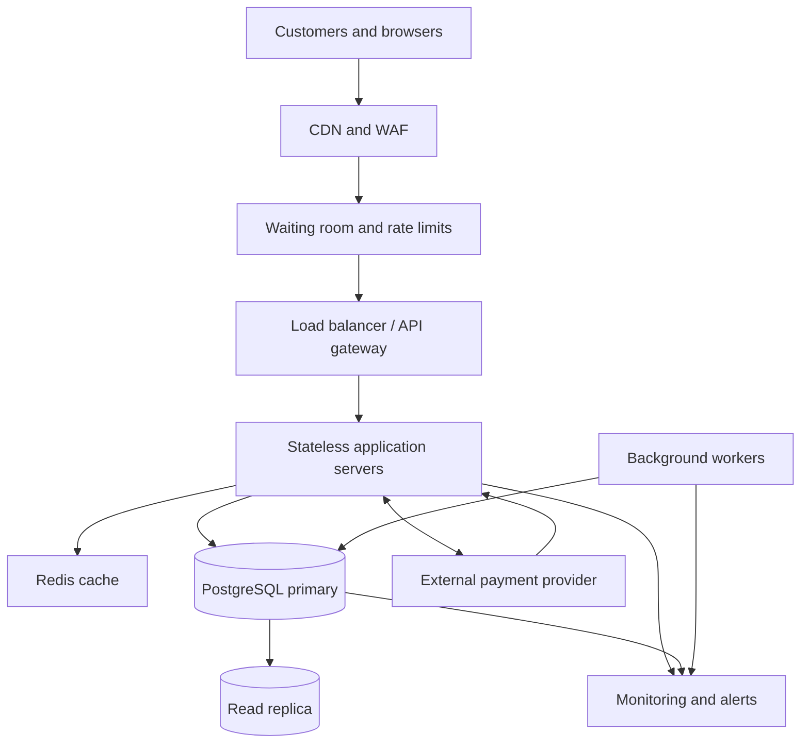

# TicketHub: Event Ticketing System Design

## 1. Context and Requirements

### 1.1 Context

TicketHub is a website that allows users to browse events, view seat availability, reserve seats temporarily, purchase tickets, and access their tickets after payment.

The system has 2 million registered users. It normally receives 50,000 visitors per day, but a popular concert can attract 200,000 people trying to buy 20,000 seats within the first 10 minutes.

The design prioritizes correct seat allocation, reliable payments, fair access, and the ability to handle sudden traffic spikes.

### 1.2 Goals

- Allow users to discover events and view seat availability.
- Let users temporarily hold available seats before paying.
- Process purchases without selling the same seat twice.
- Allow users to view their confirmed tickets and order history.
- Remain responsive and reliable during popular ticket releases.

### 1.3 Functional Requirements

1. Users can register, log in, and manage their accounts.
2. Users can browse events and view event details, prices, dates, and venues.
3. Users can view the seats available for a particular event.
4. Users can hold one or more available seats for a limited time, such as five minutes.
5. Users can pay for an order and receive confirmation when payment succeeds.
6. Users can view their purchased tickets and order history.
7. The system releases expired holds so other customers can purchase those seats.
8. The system prevents duplicate orders, duplicate payment processing, and double-booking.
9. The system displays clear messages when seats are unavailable, holds expire, or payments fail.

### 1.4 Non-Functional Requirements

**Performance**
- Target a response time below 200 ms at the 95th percentile for ordinary event browsing and cached reads under normal load.
- Target a response time below 500 ms at the 95th percentile for seat-hold requests under the planned peak load, excluding external payment-provider processing.
- Use caching for event details and other read-heavy information.

**Correctness and consistency**
- A seat must never be sold to more than one customer for the same event.
- A successful order must correspond to confirmed payment.
- Seat allocation must use database transactions and constraints.
- Payment callbacks and retried requests must be handled idempotently, meaning repeating a request must not create a duplicate purchase.

**Availability and reliability**
- Target 99.9% monthly availability as an initial service objective.
- Run multiple application instances so a single server failure does not stop the entire service.
- Back up the database and monitor database health, payment failures, and request errors.
- Recover safely from interrupted payments and expired seat holds.

**Fairness**
- Use a waiting room or queue during major ticket releases.
- Process customers according to a published queue policy rather than allowing unlimited rapid retries.
- Apply rate limits to reduce automated abuse and excessive requests.
- Give each customer a clear hold-expiration deadline and release expired holds consistently.

**Security**
- Require authentication for seat holds, purchases, and access to personal tickets.
- Enforce authorization so users can access only their own orders and tickets.
- Use a trusted payment provider and never store raw card details.
- Protect personal information and validate all inputs.

**Scalability**
- Scale application servers horizontally as demand increases.
- Separate read-heavy event browsing from transactional seat allocation.
- Protect the database from overload using queueing, rate limiting, caching, and controlled concurrency.

### 1.5 Non-Goals

- TicketHub will not initially build its own payment-processing network.
- The first version will support assigned seats rather than complex dynamic pricing.
- The design will not attempt to eliminate all bots, but it will include basic abuse prevention and queue controls.

## 2. Traffic Estimates

### 2.1 Normal Traffic

The system has 50,000 visitors per day, and each visitor views 10 pages.

- Daily page views: 50,000 × 10 = 500,000.
- Average page requests per second: 500,000 ÷ 86,400 ≈ 5.8.
- Estimated normal peak: 5 × 5.8 ≈ 29 page requests per second.
- Daily ticket sales: 5,000.
- Average ticket sales rate: 5,000 ÷ 86,400 ≈ 0.058 per second.

The normal workload is relatively small, with event browsing generating much more traffic than successful ticket sales.

### 2.2 Popular Concert Sale

During a popular concert release, 200,000 people attempt to buy 20,000 seats in the first 10 minutes.

- Purchase attempts per second: 200,000 ÷ 600 ≈ 333.
- Maximum average seat sales rate if all seats sell in 10 minutes: 20,000 ÷ 600 ≈ 33.3 seats per second.
- Average competition: 200,000 ÷ 20,000 = 10 people per seat.
- Estimated API requests: assuming four requests per buyer, 200,000 × 4 = 800,000 requests.
- Average API request rate during the sale: 800,000 ÷ 600 ≈ 1,333 requests per second.
- Estimated short-burst peak: approximately 4,000 requests per second, assuming a threefold burst over the sale average.

These estimates are approximate. Actual load depends on user behavior, retries, automated traffic, and how requests are distributed over time.

### 2.3 Comparison and Implications

| Metric | Normal day | Popular sale |
|---|---:|---:|
| Visitors or purchase participants | 50,000 daily visitors | 200,000 buyers attempting to purchase |
| Page views / relevant API requests | 500,000 page views per day | 800,000 estimated API requests in 10 minutes |
| Average request rate | 5.8 page requests/second | 1,333 API requests/second |
| Estimated burst peak | 29 page requests/second | 4,000 API requests/second |
| Ticket sales | 5,000 per day | Up to 20,000 seats in 10 minutes |

The popular sale creates a sudden increase in traffic and contention for individual seats. The architecture must handle bursty reads while ensuring that all seat allocations and purchases remain correct. A waiting room, caching, horizontally scaled application servers, and transactional database operations address these different problems.

## 3. API Design

All endpoints use JSON request and response bodies except where noted. Authenticated endpoints require a valid user session or access token.

### 3.1 Browse Events

**Request**

`GET /api/events?page=1&limit=20`

Returns a paginated list of published events.

**Success: `200 OK`**

```json
{
  "events": [
    {
      "id": "evt_101",
      "name": "Summer Music Festival",
      "venue": "Central Arena",
      "startsAt": "2027-06-15T18:00:00Z"
    }
  ],
  "page": 1,
  "limit": 20
}
```

### 3.2 View Event Details and Seat Availability

**Request**

`GET /api/events/{eventId}`

Returns the event name, venue, date, ticket prices, and sale status.

**Request**

`GET /api/events/{eventId}/seats`

Returns the seats for that event and their current availability.

**Success: `200 OK`**

```json
{
  "eventId": "evt_101",
  "seats": [
    {
      "seatId": "seat_A12",
      "label": "A12",
      "status": "available",
      "price": 75.00,
      "currency": "USD"
    },
    {
      "seatId": "seat_A13",
      "label": "A13",
      "status": "held",
      "price": 75.00,
      "currency": "USD"
    }
  ]
}
```

Seat availability is informational and can change immediately after the response. The backend must verify availability again when a hold is requested.

### 3.3 Hold Seats

**Request**

`POST /api/events/{eventId}/holds`

Requires authentication and an idempotency key to prevent duplicate holds when a request is retried.

**Request body**

```json
{
  "seatIds": ["seat_A12"],
  "idempotencyKey": "hold-request-123"
}
```

**Success: `201 Created`**

```json
{
  "holdId": "hold_501",
  "seatIds": ["seat_A12"],
  "status": "active",
  "expiresAt": "2027-06-15T17:05:00Z"
}
```

The backend atomically reserves the requested seats for five minutes. If any requested seat is unavailable, the operation fails without partially reserving the requested group of seats.

Possible errors:

- `409 Conflict`: one or more seats are already held or sold.
- `401 Unauthorized`: the user is not authenticated.
- `429 Too Many Requests`: the user has exceeded a rate limit.

### 3.4 Cancel a Hold

**Request**

`DELETE /api/holds/{holdId}`

Releases an active hold owned by the authenticated user.

**Success: `204 No Content`**

The backend checks ownership and current status before releasing the seats. Expired, sold, or otherwise finalized seats cannot be released by an ordinary cancellation request.

### 3.5 Create an Order and Pay

**Request**

`POST /api/orders`

**Request body**

```json
{
  "holdId": "hold_501",
  "idempotencyKey": "order-request-789"
}
```

The backend validates the hold and creates a pending order linked to the held seats.

**Success: `201 Created`**

```json
{
  "orderId": "ord_901",
  "status": "pending_payment",
  "amount": 75.00,
  "currency": "USD"
}
```

**Request**

`POST /api/orders/{orderId}/payment`

Starts payment through the external payment provider.

**Request body**

```json
{
  "paymentMethodToken": "provider-token-123",
  "idempotencyKey": "payment-request-456"
}
```

The token is supplied by the payment provider; raw card details are not stored by TicketHub.

**Possible responses**

- `200 OK`: payment is confirmed and the order is paid.
- `202 Accepted`: payment is still processing.
- `402 Payment Required`: payment was declined.
- `409 Conflict`: the order or hold is no longer eligible for payment.

The system verifies payment-provider callbacks before marking an order as paid and issuing tickets.

### 3.6 View My Tickets and Orders

**Request**

`GET /api/me/tickets`

Returns tickets belonging to the authenticated user.

**Success: `200 OK`**

```json
{
  "tickets": [
    {
      "ticketId": "tkt_301",
      "eventId": "evt_101",
      "eventName": "Summer Music Festival",
      "seatLabel": "A12",
      "status": "valid"
    }
  ]
}
```

The backend returns only tickets the authenticated user is authorized to view.

### 3.7 API Error Handling

Use consistent error responses:

```json
{
  "error": {
    "code": "SEAT_UNAVAILABLE",
    "message": "One or more selected seats are no longer available."
  }
}
```

Common HTTP status codes are:

- `200 OK`: successful read or completed operation.
- `201 Created`: a resource was created.
- `202 Accepted`: processing is continuing asynchronously.
- `204 No Content`: a successful operation with no response body.
- `401 Unauthorized`: authentication is required or invalid.
- `403 Forbidden`: the user lacks permission.
- `404 Not Found`: the resource does not exist.
- `409 Conflict`: a seat or order conflicts with its current state.
- `429 Too Many Requests`: the rate limit was exceeded.
- `500 Internal Server Error`: an unexpected server failure occurred.

## 4. Data Model

TicketHub uses a relational database, such as PostgreSQL, to store users, events, seats, and purchases.

### 4.1 Database Tables

#### Users

Stores registered customers.

| Column | Type | Purpose |
|---|---|---|
| `user_id` | UUID, primary key | Unique user identifier |
| `email` | VARCHAR, unique, not null | Login and contact address |
| `password_hash` | TEXT, not null | Secure password hash |
| `created_at` | TIMESTAMPTZ | Account creation time |

#### Events

Stores concert and event details.

| Column | Type | Purpose |
|---|---|---|
| `event_id` | UUID, primary key | Unique event identifier |
| `name` | VARCHAR, not null | Event name |
| `venue` | VARCHAR, not null | Venue name |
| `starts_at` | TIMESTAMPTZ, not null | Event start time |
| `status` | VARCHAR, not null | Draft, published, or cancelled |

#### Seats

Stores the physical seats available at a venue.

| Column | Type | Purpose |
|---|---|---|
| `seat_id` | UUID, primary key | Unique seat identifier |
| `venue` | VARCHAR, not null | Venue identifier or venue name |
| `seat_label` | VARCHAR, not null | Label such as A12 |
| `section` | VARCHAR | Seating section |

A unique constraint on `(venue, seat_label)` prevents duplicate seat labels within the same venue.

#### Event Seats

Stores the inventory and reservation state for each seat at each event.

| Column | Type | Purpose |
|---|---|---|
| `event_id` | UUID, foreign key | The event |
| `seat_id` | UUID, foreign key | The physical seat |
| `status` | VARCHAR, not null | Available, held, or sold |
| `price` | NUMERIC(10,2), not null | Ticket price |
| `held_by_user_id` | UUID, nullable, foreign key | User holding the seat |
| `hold_expires_at` | TIMESTAMPTZ, nullable | Hold expiration |
| `order_id` | UUID, nullable, foreign key | Order associated with the seat |

The composite primary key is `(event_id, seat_id)`. It ensures that each physical seat has only one inventory record for a particular event.

The `status` field must contain only permitted values. A database CHECK constraint should also ensure that required hold fields are populated when the status is `held`, and that they are cleared when a seat becomes available.

#### Orders

Stores purchase attempts and their final states.

| Column | Type | Purpose |
|---|---|---|
| `order_id` | UUID, primary key | Unique order identifier |
| `user_id` | UUID, foreign key, not null | Customer placing the order |
| `status` | VARCHAR, not null | Pending, paid, failed, or cancelled |
| `total_amount` | NUMERIC(10,2), not null | Total purchase amount |
| `currency` | CHAR(3), not null | Currency code |
| `payment_reference` | VARCHAR, nullable, unique | Payment-provider reference |
| `created_at` | TIMESTAMPTZ | Order creation time |

#### Order Items

Stores the seats associated with an order.

| Column | Type | Purpose |
|---|---|---|
| `order_item_id` | UUID, primary key | Unique order-item identifier |
| `order_id` | UUID, foreign key, not null | Parent order |
| `event_id` | UUID, not null | Purchased event |
| `seat_id` | UUID, not null | Purchased seat |
| `price` | NUMERIC(10,2), not null | Price agreed at purchase |

A unique constraint on `(event_id, seat_id)` in `order_items` prevents a seat from appearing in two different orders, including orders that were previously paid.

The foreign key `(event_id, seat_id)` references the composite key in `event_seats`.

### 4.2 Relationships

- One user can have many orders.
- One order can contain many order items.
- One event can have many event-seat records.
- One physical seat can have inventory records for multiple events.
- Each event-seat record identifies one physical seat for one event.
- Each order item references the event and seat that were purchased.

### 4.3 Indexes and Constraints

- Primary keys uniquely identify records.
- Foreign keys enforce valid relationships.
- Unique constraints prevent duplicate emails, physical seat labels, and purchased event-seat combinations.
- An index on `event_seats(event_id, status)` supports event-specific availability queries.
- An index on `orders(user_id, created_at)` supports order-history queries.
- An index on `event_seats(hold_expires_at)` helps workers locate expired holds.

Seat status and hold expiration must be updated transactionally. An expired hold must not automatically overwrite a seat that has already been sold.

## 5. Preventing Double-Booking

Double-booking occurs when two customers successfully purchase the same seat for the same event. This can happen when simultaneous requests both check availability before either request updates the database.

TicketHub prevents this through transactional seat allocation, row-level locking, and database constraints.

### 5.1 Seat-Hold Algorithm

When a customer requests a seat:

1. Start a database transaction.
2. Select the relevant `event_seats` row using `SELECT ... FOR UPDATE`.
3. Check the seat status and its hold expiration time using the database's current time.
4. If the seat is available, or its previous hold has expired, update its status to `held`, assign the user, and set a five-minute expiration.
5. Commit the transaction and return the hold identifier.
6. If the seat is already held or sold, roll back the transaction and return `409 Conflict`.

If several seats are requested together, lock them in a consistent order and reserve all of them in the same transaction. If any requested seat is unavailable, roll back the entire operation.

### 5.2 Why Row-Level Locking Works

Suppose Alice and Brian both request seat A12.

Alice locks the event-seat row first, checks that the seat is available, and changes its status to `held`. Brian must wait for Alice's transaction to finish. After Alice commits, Brian sees that the seat is no longer available and cannot create another hold.

All application servers use the same authoritative database, so the protection works even when requests arrive at different servers.

### 5.3 Database Constraints as a Final Safeguard

The composite primary key `(event_id, seat_id)` ensures there is only one inventory row for a given seat at a given event.

The unique constraint on `(event_id, seat_id)` in `order_items` prevents two orders from containing the same event-seat combination. These constraints provide protection even if an application-level check contains a bug.

### 5.4 Expired Holds

A background worker periodically finds expired holds. It releases a seat only if the inventory row is still held and the expiration time has passed.

The worker must update the row conditionally or lock it in a transaction. It must never blindly set a seat to available, because another transaction may already have completed a purchase.

The hold endpoint also checks expiration directly. It does not depend on the background worker running on time.

### 5.5 Completing Payment Safely

Creating a hold and completing payment are separate operations.

The system creates a pending order for the held seats and starts payment through an external provider. Payment requests use idempotency keys to avoid duplicate charges when a client retries.

After verifying a successful payment, the system uses a database transaction to mark the order as paid, mark the seats as sold, and create the tickets or order-item records. The database constraints protect the final allocation.

Payment-provider callbacks may be delivered more than once, so callbacks must also be processed idempotently.

If payment succeeds externally but TicketHub fails before recording the result, a reconciliation process checks the provider's transaction status and safely completes the order. It must not blindly release or resell the seat while payment is uncertain.

This design combines database transactions, row-level locking, unique constraints, idempotency, and payment reconciliation to prevent double-booking and reduce duplicate charges.

## 6. Architecture

### 6.1 Architecture Diagram



### 6.2 Component Responsibilities

**Customers and browsers:** Display event information, show seat availability, and submit hold and purchase requests.

**CDN and Web Application Firewall (WAF):** Serve static content close to users and help block malicious traffic. Public event information may also be cached.

**Waiting room and rate limits:** Control admission during major sales, prevent uncontrolled request spikes, and reduce automated abuse. A queue provides orderly access but cannot guarantee every customer a ticket.

**Load balancer and API gateway:** Distribute requests across healthy application servers and centralize routing, authentication checks, and request limits.

**Stateless application servers:** Run the event, seat-hold, order, payment, and ticket APIs. Multiple instances can be added or removed without moving session state between servers. Durable business state lives in the database.

**Redis cache:** Cache event descriptions, venue information, and other read-heavy data. Seat availability shown from a cache is only advisory. Holds and purchases must always be verified against PostgreSQL.

**PostgreSQL primary:** Stores authoritative seat inventory, orders, and relationships. Transactions, row-level locks, primary keys, and unique constraints protect seat allocation. All competing hold and purchase requests use the same authoritative database.

**Read replica:** Serves suitable read-only queries, such as some event and reporting queries, to reduce load on the primary. It may lag behind the primary, so it must not be used to decide whether a seat can be sold.

**External payment provider:** Processes payments securely and sends payment results to TicketHub. TicketHub verifies provider callbacks and uses idempotency and reconciliation to handle retries and failures.

**Background workers and queue:** Process hold expiration, email notifications, and payment reconciliation. Workers use conditional database updates and must be safe to retry.

**Monitoring and alerts:** Track request rates, latency, errors, database contention, queue delays, payment failures, and expired holds. Alerts help operators identify problems before they become prolonged outages.

### 6.3 How the Architecture Handles a Big Sale

During a popular concert release, the waiting room controls the rate at which requests reach the API. The load balancer distributes admitted requests across several application servers.

The CDN and Redis cache reduce repeated work for public event pages and static content. Read replicas handle suitable browsing queries, while seat holds and purchases go to the authoritative PostgreSQL primary.

PostgreSQL serializes conflicting changes to the same seat using row-level locks and enforces uniqueness constraints. If two users compete for the same seat, only one can successfully hold it.

Queue workers release expired holds, process asynchronous tasks, and reconcile uncertain payments. Monitoring alerts operators when request latency, database locks, errors, or queue lengths rise.

The application tier scales horizontally, but the database remains a potential bottleneck because all authoritative seat changes must be coordinated. The waiting room and controlled admission rate protect it from overload.

The system should be load-tested before the sale. If demand exceeds capacity, it should slow admission and return clear retry responses rather than accept purchases it cannot process safely.

## 7. Trade-Offs and Alternatives

### 7.1 Strong Consistency vs. Higher Throughput

**Decision:** Use PostgreSQL transactions, row-level locks, and unique constraints for seat allocation.

**Benefit:** The database provides authoritative, consistent decisions and prevents two customers from reserving or purchasing the same seat.

**Cost:** Concurrent requests for the same seat must wait, and a heavily contested sale can increase database lock contention.

**Alternative:** Use a distributed seat-allocation service or partition inventory across multiple systems. These approaches may improve throughput but add complexity and require careful coordination to preserve correctness.

**Reason for the decision:** Preventing double-booking is more important than accepting every request immediately.

### 7.2 Waiting Room vs. Immediate Access

**Decision:** Use a waiting room and controlled admission during major ticket releases.

**Benefit:** The waiting room smooths sudden traffic spikes and protects the application and database from overload.

**Cost:** Customers may wait before entering the site, and the queue adds another component that must remain reliable.

**Alternative:** Let every request reach the application immediately and rely on autoscaling. This is simpler for small sales but can overwhelm a database before new capacity becomes available.

**Reason for the decision:** A controlled, predictable sale is preferable to a system that becomes unresponsive under sudden demand.

### 7.3 Cache Performance vs. Freshness

**Decision:** Cache public event details and use read replicas for suitable read-only queries.

**Benefit:** Most browsing requests can be served without reaching the primary database, improving response time and reducing database load.

**Cost:** Cached information and replicas may be stale. Customers may briefly see a seat as available when it has already been held.

**Alternative:** Read every request directly from the primary database. This improves freshness but increases load and may reduce browsing performance during a sale.

**Reason for the decision:** Slightly stale seat-map information is acceptable if every hold and purchase is checked against the authoritative database.

### 7.4 Simple Hold Expiration vs. Payment Delays

**Decision:** Use short, time-limited holds with background cleanup and payment reconciliation.

**Benefit:** Seats are not reserved indefinitely by customers who abandon the purchase process.

**Cost:** A payment may take longer than expected, creating a risk that the hold expires while payment is still processing.

**Alternative:** Use longer holds or an explicit payment-in-progress state with a controlled extension policy. This can reduce failed purchases but may temporarily block seats for other customers.

**Reason for the decision:** Begin with five-minute holds, define how in-progress payments are protected from accidental resale, and measure real payment completion times before adjusting the policy.

### 7.5 Risks and Open Questions

- What is the maximum acceptable waiting time during a popular sale?
- What is the measured capacity of the database under heavy seat contention?
- How should the system handle payments that succeed after a hold expires?
- What rules should govern queue ordering, bot detection, and per-user purchase limits?
- How much geographic redundancy is justified by the service's availability target?

These questions should be resolved through load testing, payment-provider integration tests, and operational experience.

